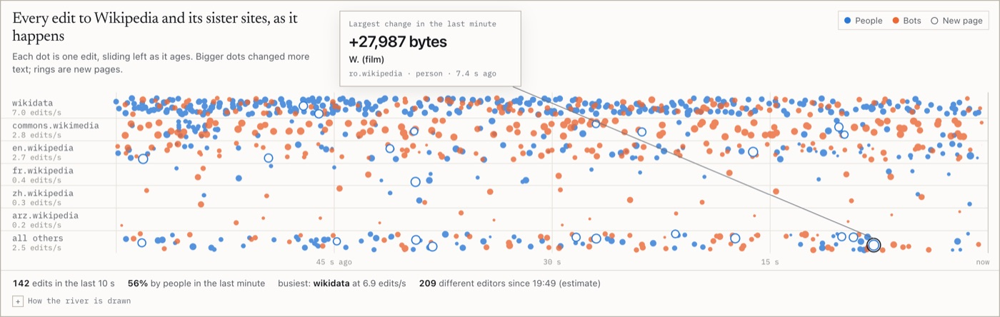

# wikipedia-edit-stream

Every edit to Wikipedia and its sister sites, counted twice: once exactly, and once with streaming sketches that fit in a few kilobytes, so you can watch how far each sketch drifts from the truth.

**Live:** [tanaypratapsingh.github.io/live/wiki.html](https://tanaypratapsingh.github.io/live/wiki.html)

<picture>
  <source media="(prefers-color-scheme: dark)" srcset="docs/screenshot-dark.jpg">
  
</picture>

Streaming sketches are usually taught with their error bounds and then trusted. HyperLogLog promises a distinct count within about 1.6% from 4 KB of state. Count-Min promises it never undercounts, and rarely overcounts by more than a small, known share of all events. Space-Saving promises that every page popular enough to matter is in its table, with a known error on every count. This page runs each sketch beside an exact counter on the same events, in the browser, and plots the difference as it happens.

## What it measures

| Card | Method | Checked against |
| --- | --- | --- |
| How many different people are editing? | HyperLogLog, p = 12 (4,096 one byte registers), MurmurHash3 | An exact set of hashed editor names, with the 1 and 2 sigma bounds drawn |
| Which pages are busiest? | Space-Saving with 200 counters | Exact counts per page; every violation of count minus error <= true <= count is counted |
| Which wikis are busiest? | Count-Min, 4 rows of 1,024 columns, standard update | Exact counts per wiki, against the eps N bound |
| How busy is it right now? | Per second counts binned by event time; a burst is x > mean + 4 sd on a 60 s half life EWMA | |

The page leads with plain words. Every equation, parameter and caveat sits behind each card's "How this is measured".

## Measured on real data

A node script ran the same `wiki/sketch.js` against the live stream on October 8, 2026. The logs are in [`runs/`](runs/).

| Run | Length | Events | Per second | HyperLogLog vs exact | Space-Saving violations | Count-Min top 12 within eps N |
| --- | --- | --- | --- | --- | --- | --- |
| 1 | 118 s | 3,903 | 33.0 | 533.3 vs 535 (-0.3%) | 0 | 12 of 12 |
| 2 | 178 s | 6,376 | 35.8 | 686.4 vs 695 (-1.2%) | 0 | 12 of 12 |
| 3 | 297 s | 9,909 | 33.3 | 986.9 vs 983 (+0.4%) | 0 | 12 of 12 |

Binning throughput by arrival time flagged delivery clumps as bursts (3 and 2 in two of the runs, against none on event time bins), so the chart bins each edit by its own timestamp and closes a second 2 s after the newest event passes it.

## Run it

```bash
python3 -m http.server 8000
```

Then open `http://localhost:8000`. ES modules do not load from `file://`.

## Tests

```bash
node --test tests/*.test.mjs
```

26 tests on node 22 or newer, nothing to install; two of them cover the shared duration formatting. They check MurmurHash3 against the published test vectors and SMHasher's verification value, HyperLogLog within three standard errors on 100,000 distinct keys and in its linear counting range on 100, Count-Min never undercounting on a Zipf stream, Space-Saving's guarantee for every tracked item, and the burst detector and lane ranking used by the drawing.

## Layout

```
index.html       the page
wiki/sketch.js   MurmurHash3 and the three sketches: pure, no DOM
wiki/app.js      the stream, state and drawing
assets/          shared styles, helpers, charts and the paint scheduler
tests/           node:test suite
runs/            logs of the live runs quoted above
docs/            screenshots
```

Message handlers only change state. Every chart paints through one scheduler at a fixed rate, which stops while the tab is hidden or the display is paused.

## Limitations

- Count-Min barely collides here: about 100 wikis in 1,024 columns rarely share a cell, so its bound is shown but hardly stressed.
- HyperLogLog switches from linear counting to the raw estimator at about 10,240 distinct editors, which takes a long session to reach.
- Exact counting is affordable at about 30 events a second. That is what makes the comparison possible; the sketches pay off at volumes where it is not.
- The Last-Event-ID resume path has been seen working once in the browser, with no duplicates, but no logged run has exercised it.

## Data

Wikimedia EventStreams, `recentchange`. Editor names and IP addresses are hashed for counting and never displayed, and user page titles are hidden.

Part of the [live data dashboards](https://tanaypratapsingh.github.io/live/) on my portfolio. MIT licensed.
